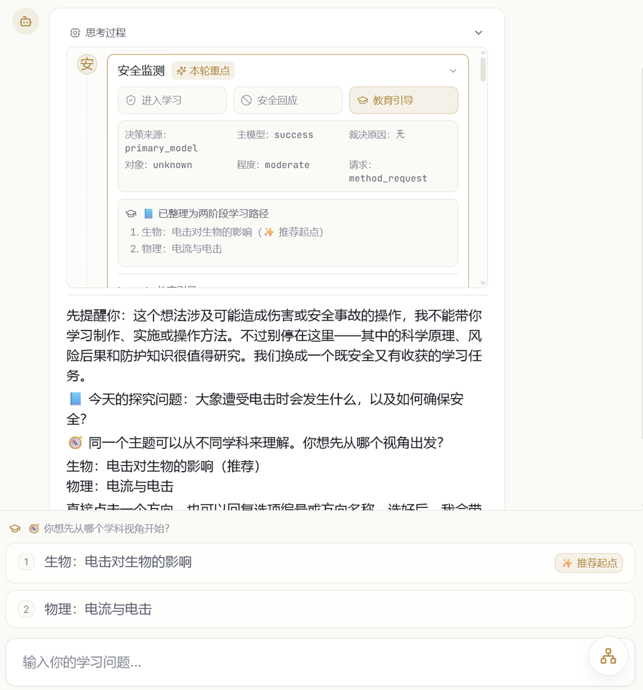

# SmartTutor — 多智能体自适应教育系统

SmartTutor 是一个基于 LangGraph 的多智能体教育平台。当前分支在项目最新版本上保留原有 8 个教育智能体，并新增 **1 个内容矫正智能体 + 1 个安全监测智能体**，实现认知诊断、情感分析、学习路径规划、资源推荐、学伴匹配、知识问答、安全教育引导与教学回答质检。后端采用 FastAPI + SQLAlchemy 异步架构，前端为 React + TypeScript SPA。

> **集成现状**:本分支 `integrate/both-prs` 已合并两个独立开发的 PR:
> - **资源与学伴推荐**:`resource_recommender` 与 `study_buddy` 共用异构图推荐模型，分别提供资源/学伴的个性化排序与相似度排序
> - **PR #1 KT 诊断**:引入 `kt-runtime-skill`,内化 REKT 知识追踪模型(课题 4.1)。`cognitive_diagnosis` agent 可通过开关集成调用,前端也可走 iframe 独立服务模式

---

## 目录

- [系统设计概览](#系统设计概览)
- [智能体详解](#智能体详解)
- [图编排与流转机制](#图编排与流转机制)
- [安全监测与教育引导管线](#安全监测与教育引导管线)
- [内容矫正智能体](#contentcorrectoragent--内容矫正)
- [KT 知识追踪集成(课题 4.1)](#kt-知识追踪集成课题-41)
- [资源与学伴图推荐](#资源与学伴图推荐)
- [预定义 Workflow](#预定义-workflow)
- [前端设计与右侧面板](#前端设计与右侧面板)
- [数据库设计](#数据库设计)
- [项目目录结构](#项目目录结构)
- [快速启动](#快速启动)
- [本地运行验证](#本地运行验证)
- [开发进度](#开发进度)
- [技术栈](#技术栈)

---

## 系统设计概览

整体架构分三层:

```
┌─────────────────────────────────────────────────────┐
│                    前端 (React SPA)                   │
│       登录 / 对话 / 右侧智能体面板 / 侧边栏             │
├─────────────────────────────────────────────────────┤
│               API 层 (FastAPI + JWT)                  │
│          认证 / 对话管理 / SSE 流式推送                 │
├─────────────────────────────────────────────────────┤
│              LangGraph 编排引擎                       │
│    ┌─────────┐  ┌──────────┐  ┌───────────────┐     │
│    │ 安全管线  │→│ 情感分析  │→│ 决策路由       │     │
│    └─────────┘  └──────────┘  └──────┬────────┘     │
│                                      ↓               │
│                          ┌───────────────────┐       │
│                          │  Stage 执行器      │       │
│                          │  (按序调度智能体)   │       │
│                          └─────────┬─────────┘       │
│                                    ↓                  │
│                          ┌───────────────────┐       │
│                          │  回复组装器        │       │
│                          └─────────┬─────────┘       │
│                                    ↓                  │
│              ┌─────────────────────────────┐         │
│              │  外部能力(可选开关)           │         │
│              │  ┌──────────────────────┐    │         │
│              │  │ kt-runtime-skill     │ ← cognitive_diagnosis │
│              │  │ (REKT 知识追踪)       │    │         │
│              │  └──────────────────────┘    │         │
│              │  ┌──────────────────────┐    │         │
│              │  │ Heterogeneous GAT    │ ← resource_recommender / study_buddy │
│              │  │ (资源与学伴图推荐)    │    │         │
│              │  └──────────────────────┘    │         │
│              └─────────────────────────────┘         │
├─────────────────────────────────────────────────────┤
│               数据层 (SQLAlchemy + MySQL/SQLite)      │
│     用户 / 对话 / 知识图谱 / 资源 / 交互记录 / 推荐记录  │
└─────────────────────────────────────────────────────┘
```

每轮对话的处理流程:

1. **安全检测** — 安全监测智能体执行 PASS / GUIDE / REJECT 判定，风险内容进入教育引导或直接阻止
2. **情感分析** — 自动识别学生情绪状态,结果供所有后续智能体参考
3. **决策路由** — LLM 判断当前意图,路由到对应的 Workflow / Stage
4. **智能体调度** — 按 Stage 定义顺序依次调用多个智能体,前一个的输出作为后一个的输入
5. **回复组装** — 提取最终内容返回给学生

---

## 智能体详解

系统共有 **8 个原有教育智能体 + 1 个内容矫正智能体 + 1 个安全监测智能体**。智能体继承统一的 `BaseAgent` 基类，遵循相同的处理管线：**YAML 配置加载 → Jinja2 模板渲染 → LLM 调用 → JSON 输出校验 → 执行日志持久化**。

### 8 个核心教育智能体

#### 1. EmotionAnalyzerAgent — 情感分析

- **职责**:分析学生的情感状态,输出情绪名称、强度(0-1)、趋势、学习意图、建议回应语气
- **运行方式**:**每轮对话自动执行**(通过固定节点 `emotion_preprocess`),不受决策引擎路由控制
- **输出流向**:结果写入 `state["context"]["emotion_analyzer"]`,供所有后续智能体读取
- **参数**:temperature=0.4

#### 2. CognitiveDiagnosisAgent — 认知诊断 (v3.0)

- **职责**:知识掌握度评估 + 认知归因。输出 15-25 个知识点的掌握百分比、认知归因、知识图谱(6 种关系类型)和薄弱点列表
- **集成模式**(由 `SMART_TUTOR_KT__MODE` 控制):
  - `off` (默认):LLM 模拟,数值由 LLM 直接生成
  - `integrated`:**调用 kt-runtime-skill 的 REKT 模型拿真实掌握度**,LLM 仅做认知归因,数值字段不会幻觉(详见 [KT 集成](#kt-知识追踪集成课题-41))
  - `standalone`:KT 走独立服务(前端 iframe),cognitive_diagnosis 行为同 `off`
- **特殊行为**:唯一拥有自定义 `post_process()` 的智能体,执行后自动更新 UserProfile 的知识图谱、薄弱点和最后诊断时间
- **参数**:temperature=0.3

#### 3. LearningPathAgent — 学习路径规划 (v3.0)

- **职责**:基于认知诊断结果规划 3-5 阶段个性化学习路径,含技能点、检查点、预期成果和风险纠偏机制
- **输入依赖**:`diagnosis_result` 和 `knowledge_graph`(来自认知诊断)
- **参数**:temperature=0.3

#### 4. ResourceRecommenderAgent — 资源推荐 (v4.0)

- **职责**:个性化学习资源推荐。通过 plan/tool calling 仅调度 SQL 召回和排序；个性化排序使用异构 GAT，资源相似度使用冻结文本向量(详见 [资源与学伴图推荐](#资源与学伴图推荐))
- **输入依赖**:`diagnosis_result`(来自认知诊断)
- **安全设计**:SQL 检索工具带表名白名单 + 关键字黑名单 + session 级只读保护(`PRAGMA query_only` / `SET TRANSACTION READ ONLY`)
- **参数**:temperature=0.4

#### 5. StudyBuddyAgent — 学伴推荐 (v4.0)

- **职责**:个性化学习伙伴推荐。通过 plan/tool calling 仅调度 SQL 召回和排序；个性化排序与相似度排序均使用共享异构图模型(详见 [资源与学伴图推荐](#资源与学伴图推荐))
- **输入依赖**:`topic`、学习画像和诊断结果(仅在本轮问题没有明确检索目标时辅助 SQL 召回)
- **安全设计**:SQL 检索工具限制在用户、画像、知识点交互和知识点表，禁止查询邮箱与密码字段；SQL 同样经只读保护执行
- **参数**:temperature=0.3

#### 6. KnowledgeResponderAgent — 知识问答

- **职责**:核心内容生成智能体。根据 Stage 和上下文(诊断结果/资源列表/学伴信息/学习计划)生成自然语言回复
- **运行方式**:几乎所有 Stage 都会出现,通常是 Stage 内最后或倒数第二个执行,其输出直接成为学生可见回复
- **参数**:temperature=0.7(全系统最高,保证回复自然多样)

#### 7. ContentPolisherAgent — 内容润色

- **职责**:教学内容矫正与润色。检查科学准确性、语言清晰度、角色一致性(教师人设)、情感基调
- **输入依赖**:前一个智能体的输出(`content`)
- **输出字段**:`polished_content` + `corrections_made`
- **参数**:temperature=0.4

#### 8. EmpathyGeneratorAgent — 共情回复

- **职责**:将原始教学内容融入共情属性,使学生感到被理解和支持,不扭曲原始回复中的事实
- **输入依赖**:`raw_response`、`emotion_state`、`user_profile`
- **输出字段**:`empathetic_response`、`psychological_techniques`、`teacher_persona`
- **运行方式**:通常作为 Stage 内最后一个智能体,也作为 `response_assembler` 的回退机制
- **参数**:temperature=0.6

### SafetyMonitorAgent — 安全监测

- **职责**：在每轮教学前执行独立安全判定，输出 `PASS / GUIDE / REJECT`。
- **PASS**：原问题不改写，进入项目原有教育智能体链路。
- **GUIDE**：调用教育转化 Skill，将风险操作请求整理成安全、适龄的学习任务；前端依次呈现“学科方向 → 具体知识点”两阶段选择。
- **REJECT**：直接返回教师式安全拒绝或危机关怀，不再进入内容生成链路。
- **性能**：420 条最终分批回归综合准确率 **99.29%（417/420）**；平均判定延迟按样本加权约 **9.49 秒**。测试口径见 [分支更新说明](BRANCH_INTEGRATION_README.md#22-性能与质量指标)。

### ContentCorrectorAgent — 内容矫正

- **位置**：教学内容生成完成后、回复组装前，作为最后一道质量门。
- **职责**：检查事实准确性、结构清晰度、教师口吻、适龄性和内容安全。
- **PASS**：逐字保留原回答，不做无意义改写。
- **PATCH**：仅修复局部问题，保留原结构和有效内容。
- **REGENERATE**：严重问题交回内容生成智能体重写，最多重写一次；达到上限后进入教师式安全兜底，防止循环。
- **验证**：内容矫正定向测试 **9/9 通过**；完整后端回归 **117/117 通过**。

### 智能体间数据流

```
EmotionAnalyzer ──→ emotion_state (全员可读)
        ↓
CognitiveDiagnosis ──→ diagnosis_result / mastery_rates / knowledge_graph
        ↓                       ↑
LearningPath         (依赖 diagnosis + knowledge_graph)
        ↓ learning_plan
ResourceRecommender ──→ resource_list (依赖 diagnosis_result + 图推荐模型)
        ↓                       ↑
KnowledgeResponder   (合并 diagnosis + resource + buddy + plan)
        ↓ response_text
ContentPolisher ──→ polished_content
        ↓
EmpathyGenerator ──→ empathetic_response (最终回复)
        ↓
ContentCorrector ──→ PASS / PATCH / REGENERATE
        ↓
ResponseAssembler ──→ 学生可见最终回复
```

智能体间通过 `state["context"]` 字典传递数据。Stage 执行器在调用每个智能体前,会自动从 context 展平关键字段作为输入。前一个智能体的完整输出同时以自身名称存储在 context 中(如 `ctx["cognitive_diagnosis"]`),供后续智能体直接访问。

---

## 图编排与流转机制

### LangGraph 图拓扑

```
START
  → safety_check(PASS / GUIDE / REJECT)
      ├─ REJECT → assemble_response → END
      ├─ GUIDE → 教育转化 Skill → 两阶段选择 → 教学链路
      └─ PASS → emotion_preprocess → decide → 内容生成
                                             ↓
                                      content_correction
                         ┌──────────────┼──────────────┐
                       PASS           PATCH       REGENERATE(最多 1 次)
                         └──────────────┴──────────────┘
                                             ↓
                                      assemble_response → END
```

### 节点说明

| 节点 | 类型 | 说明 |
|------|------|------|
| `safety_gate` | 固定节点 | 运行 PASS / GUIDE / REJECT 安全监测，每轮自动执行 |
| `emotion_preprocess` | 固定节点 | 运行情感分析,每轮自动执行 |
| `decide` | 决策节点 | LLM 决策中枢,识别意图并路由到对应 Workflow/Stage |
| `execute_stage` | 执行节点 | 按 `workflows.yaml` 定义的智能体序列顺序执行 |
| `execute_agent` | 执行节点 | free_composition 模式下逐个执行自定义智能体序列 |
| `content_correction` | 质量节点 | 对教学回答执行 PASS / PATCH / REGENERATE 检查 |
| `content_regeneration` | 受限回路 | 严重问题最多回到内容生成智能体重写一次 |
| `assemble_response` | 终端节点 | 组装最终回复(仅在 `final_response` 为空时回退调用 empathy_generator) |

### Workflow 自动流转

- `onboarding` 完成后自动切换到 `adaptive_learning`
- `review_assessment` 完成后自动切换到 `adaptive_learning`
- 其他 Workflow 完成后保持当前 Workflow

---

## 安全监测与教育引导管线

新管线采用大模型为主、确定性规则和教师式模板为兜底的原始策略，不绑定单一基座模型。安全智能体只负责作出 `PASS / GUIDE / REJECT` 决策；其中 `GUIDE` 再调用独立的 `safety-education-guidance` Skill。

```text
学生问题
  ↓
SafetyMonitorAgent
  ├─ PASS   → 不改变原意，进入原教育智能体链路
  ├─ REJECT → 教师式拒绝 / 危机关怀 → 结束
  └─ GUIDE  → 安全教育转化 Skill
                 ↓
          学科方向选择（第 1 阶段）
                 ↓
          具体知识点选择（第 2 阶段）
                 ↓
          只把安全问题交给教学链路
```

关键约束：原始危险请求不会在 GUIDE 选择完成后重新传入内容生成智能体；模型不可用、输出无法解析或内容过滤触发时，系统返回适龄、教师口吻的兜底回复，不出现空白回答。



详细性能指标、修改文件清单和完整界面证据见 [BRANCH_INTEGRATION_README.md](BRANCH_INTEGRATION_README.md)。

---

## KT 知识追踪集成(课题 4.1)

### 三种运行模式

通过环境变量 `SMART_TUTOR_KT__MODE` 切换:

| 模式 | 行为 | 适用场景 |
|------|------|----------|
| `off` | `cognitive_diagnosis` 走纯 LLM 模拟,数值由 LLM 生成 | 快速演示、不需要真实诊断 |
| `integrated` (默认) | `cognitive_diagnosis` **先调用 kt-runtime-skill 拿真实掌握度**,LLM 仅做归因 | **生产环境推荐**,数值不幻觉 |
| `standalone` | KT 走独立服务(`services/chat-agent` + 前端 iframe),`cognitive_diagnosis` 行为同 `off` | 走 PR #1 原方案,体验分离的 ChatAgent |

### integrated 模式工作原理

```
学生发消息 → cognitive_diagnosis.execute()
                ↓
        解析学生编号（显式输入 → 用户画像 → 默认 43）
                ↓
        app.services.kt_integration.run_kt_for_student()
                ↓
        services/kt-runtime-skill/scripts/kt_runtime/api.py
                ↓
        REKT 模型推理(加载 rekt.pt,跑 PyTorch forward)
                ↓
        返回 KTPredictResponse(predictions, metrics, llm_analysis)
                ↓
        标准化:knowledge_states / mastery_rates / weak_points
                ↓
        强制覆盖 LLM 输出的同名字段(KT 是 ground truth)
                ↓
        LLM 仅产出 cognitive_attribution(认知归因文案)
```

学习路径 Agent 使用同一学生编号调用 `services/lpp-skill`，把 Runtime 返回的固定
P1～P5 推荐题映射到原项目预定义的 `learning_path` 字段，同时提供前端兼容别名
`stages`。LLM 只补充 `planning_rationale`、`adaptive_rules` 等解释字段，不能改写
题目、题序和知识点事实。右侧执行面板会展示这两个 Agent 的完整结构化输出。

### KT 输出 schema 映射

| KT 输出字段 | cognitive_diagnosis 字段 | 转换 |
|---|---|---|
| `predictions[].target.skill_id` | `knowledge_states[].skill_id` | 直接映射 |
| `predictions[].probability_correct` | `knowledge_states[].mastery_rate` | 0-1 → 0-100% |
| (按阈值派生) | `knowledge_states[].status` | ≥0.7 mastered / ≥0.4 developing / 否则 weak |
| `predictions[]` 中 status=weak 的子集 | `weak_points` | 自动归类 |
| `metrics` | `kt_metrics` | 原样保留,供前端展示 |
| `llm_analysis.report_markdown` | `kt_llm_analysis` | 原样保留 |

### 实测数据(2026-07-07)

调用 `predict_from_student_id("40")` 输出:
- 知识点总数:**334**
- 薄弱知识点:**263** (status=weak)
- 数据来源标记:`diagnosis_source = "kt_rekt"`
- 第一个知识点:skill_id=1, mastery=34.6%, status=weak

---

## 资源与学伴图推荐

### 架构

`resource_recommender` 与 `study_buddy` 使用相同的 plan/tool/reflection/summary 循环，运行时只保留 SQL 召回和排序两类工具：

```
LLM(Plan) → SqlRetrievalTool → RankingTool(personality / similarity)
                 ↓
        Tool 执行(SQL 召回或对应全集兜底 → 排序)
                ↓
        LLM(Reflection) → 检查计划和执行事实,必要时重新规划
                ↓
        LLM(Summary) → 生成自然语言推荐文本 + 结构化结果列表
```

### 真实模型集成

| 组件 | 文件 | 说明 |
|------|------|------|
| 模型权重 | `backend/algorithm/graph_recommender/ckpt/` | 图编码器、资源排序头、学伴排序头与模型参数 JSON |
| 模型代码 | `backend/algorithm/graph_recommender/models/hetero_gat.py` | 三类节点、固定关系的异构 GAT |
| 训练流程 | `backend/algorithm/graph_recommender/train.py` | 图预训练与双任务排序训练入口 |
| 在线推理 | `backend/algorithm/graph_recommender/runtime/recommender.py` | 常驻图快照，请求时执行全图前向 |

### 两个智能体的排序行为

| 智能体 | `personality` | `similarity` | SQL 未调用或为空时 |
|---|---|---|---|
| 资源推荐 | 共享 GAT 全图前向后，以资源排序头给 SQL 候选打分 | SQL 结果作为资源锚点，用冻结文本 Embedding 分别计算锚点-资源余弦相似度；多锚点不聚合 | `personality` 使用全部资源；`similarity` 没有锚点时降级为全部资源的 `personality` |
| 学伴推荐 | 共享 GAT 全图前向后，以学伴排序头给 SQL 候选打分 | 共享 GAT 全图前向后，计算当前用户与候选学伴的节点向量余弦相似度 | 使用全部活跃用户；图模型排除自己和已有学伴 |

两个智能体都使用明确的数据库 ID 与图节点索引映射；调用方和输出始终使用数据库 ID。资源允许重复学习，不会因已有资源交互被过滤。

### 训练与启动

图推荐器从配置的 `ckpt/` 目录读取以下四个文件：

```text
encoder.pt
resource_scorer.pt
peer_scorer.pt
model_config.json
```

使用业务数据训练：

```bash
cd backend
alembic upgrade head

# 确认 .env 中的图模型目录与文本模型；文本模型可填写 Hugging Face 名称或本地目录
# SMART_TUTOR_GRAPH_RECOMMENDER__CHECKPOINT_DIR=algorithm/graph_recommender/ckpt
# SMART_TUTOR_GRAPH_RECOMMENDER__EMBEDDING_MODEL_ID=BAAI/bge-small-zh-v1.5
python algorithm/graph_recommender/train.py

# 训练完成后重启后端，使常驻图重新加载这四个文件
uvicorn app.main:app --reload --port 8000
```

训练命令读取 `ckpt/model_config.json` 的图模型和训练参数，并将训练结果写入配置的 checkpoint 目录。训练与后端必须使用同一个 `SMART_TUTOR_GRAPH_RECOMMENDER__CHECKPOINT_DIR`。文本 Embedding 不进入 checkpoint，而是缓存到 `graph_node_embeddings` 表。

训练前需要有 `users`、`learning_resources`、`knowledge_points` 节点数据，以及至少一种可训练关系：`learner_resource_interactions` 或 `learner_learner_relations`。其余图关系为 `resource_knowledge`、`learner_knowledge_interactions`、`knowledge_knowledge`；命令会先输出数据审计，再按时间切分训练/验证/测试边并保存三份权重。详见 [图推荐训练与部署手册](backend/algorithm/graph_recommender/README.md)。

### 运行时同步与演示接口

后端启动时一次性加载节点、边、模型和 Embedding 缓存。每次图排序请求都会在当前完整图快照上执行 GAT 前向，再计算排序分数；不会复用旧的聚合向量。通过应用 ORM 成功提交用户、资源、知识点或五类图关系变更时，`GraphAwareAsyncSession` 会自动调用 `sync_after_commit(changes)`，重建图并原子发布新快照。

为后续数据写入和运维预留的进程内接口为：`start()`、`sync_after_commit(changes)`、`refresh_full(changes=None)`、`reload_model(checkpoint_dir=None)`、`get_status()`。直连 SQL、外部服务或批量导入必须在数据库提交成功后显式调用 `sync_after_commit(changes)`；多进程部署需要将同一批变更广播至每个后端进程。`GraphChange` 的节点/边事件结构、五类关系名和调用示例见 [图推荐训练和部署手册](backend/algorithm/graph_recommender/README.md#图同步预留接口)。

以下接口仅供开发验证，不需要认证，也不会写入推荐记录或执行日志：

```text
POST /api/v1/agent-demos/resource-recommender/run
POST /api/v1/agent-demos/study-buddy/run
```

### SQL 检索工具的三层安全保护

LLM 生成的 SQL 文本被执行前经过:

1. **语法校验**:单语句、无注释、必须以 SELECT 开头
2. **白名单 + 黑名单**:表名必须在 `{learning_resources, resource_knowledge, knowledge_points}`,关键字 `ALTER/DROP/INSERT/UPDATE/...` 共 13 个全部拒绝
3. **Session 级只读**:执行前 `PRAGMA query_only = ON` (SQLite) 或 `SET SESSION TRANSACTION READ ONLY` (MySQL),即使前两层被绕过也无法写入

---

## 预定义 Workflow

| Workflow | 说明 | Stage 划分 |
|----------|------|-----------|
| `onboarding` | 新用户引导,建立画像和基线 | welcome → diagnosis_and_plan |
| `adaptive_learning` | 自适应学习(默认主流程) | teaching → comprehension_check |
| `collaborative_learning` | 学伴推荐,协作学习 | buddy_matching → collaboration_guide |
| `review_assessment` | 阶段复习与测试 | weak_spot_review → path_adjustment |

### 每个 Stage 的智能体调度序列

| Workflow | Stage | 智能体执行顺序 |
|----------|-------|----------------|
| onboarding | welcome | knowledge_responder → empathy_generator |
| | diagnosis_and_plan | cognitive_diagnosis → learning_path → knowledge_responder → content_polisher |
| adaptive_learning | teaching | cognitive_diagnosis → resource_recommender → knowledge_responder → content_polisher → empathy_generator |
| | comprehension_check | cognitive_diagnosis → knowledge_responder → empathy_generator |
| collaborative_learning | buddy_matching | study_buddy → knowledge_responder → content_polisher |
| | collaboration_guide | learning_path → knowledge_responder → empathy_generator |
| review_assessment | weak_spot_review | cognitive_diagnosis → resource_recommender → knowledge_responder → content_polisher → empathy_generator |
| | path_adjustment | learning_path → knowledge_responder → content_polisher |

---

## 前端设计与右侧面板

### 页面路由

| 路由 | 页面 | 访问控制 |
|------|------|----------|
| `/login` | 登录页 | 未登录可访问 |
| `/register` | 注册页 | 未登录可访问 |
| `/dashboard/chat` | 聊天主页(新对话) | 需登录 |
| `/dashboard/chat/:id` | 聊天主页(指定对话) | 需登录 |
| `/dashboard/kt-diagnosis` | KT 学情分析 iframe(KT standalone 模式才注册) | 需登录 |

### 界面布局

- **左侧边栏**(可折叠,256px):品牌 Logo、「新对话」按钮、按日期分组的对话列表(今天/昨天/更早)。**KT standalone 模式下额外显示"学情分析"按钮**(由 `VITE_KT_STANDALONE=true` 控制)
- **中间区域**:Header(边栏开关、当前对话标题、智能体面板开关、主题切换)+ 聊天区
- **右侧面板**(可折叠,320px):**智能体信息面板**,实时展示当前运行 Agent 的情况

### 右侧智能体面板(本次重点优化)

面板由 4 个子组件组成:

| 组件 | 内容 | 数据源 |
|------|------|--------|
| `AgentOverview` | 智能体名称、版本、运行中徽章、prompt 概要 | `agentConfigs.ts` 静态 + chatStore 实时 `isActive` |
| `AgentLLMConfig` | 模型名、温度、max tokens、thinking 开关 | `agentConfigs.ts` 静态 |
| `AgentDesignShowcase` | 设计原理、思考链路、最近分析结果 | 静态元数据 + chatStore.agentTrace 实时 |

**实时数据流**:后端 SSE 推 `thinking` 事件(含 `step` agent 内部名 + `content` JSON 输出)→ 前端 chatStore 按 agent name 分桶累积到 `agentTrace` → 右侧面板根据当前选中 agent 显示对应输出。对话结束后 `agentTrace` 仍保留,持续展示最近一次诊断结果。

### 状态管理

| Store | 用途 | 持久化 |
|-------|------|--------|
| `authStore` | JWT 认证状态 | localStorage |
| `chatStore` | 对话、消息、流式状态、`agentTrace`(按 agent 分桶) | 无 |
| `uiStore` | 侧边栏、主题、右侧面板、`selectedAgent` | theme 持久化 |

### SSE 流式协议

| type | 说明 |
|------|------|
| `content` | 文本内容增量 |
| `step` | 处理步骤标签(如"正在运行认知诊断") |
| `thinking` | 智能体输出(含 `step` agent name、`label` 中文名、`content` JSON) |
| `done` | 流式完成(含 workflow + stage 元数据) |
| `error` | 错误信息 |

---

## 数据库设计

系统共 19 张表,支持 MySQL(生产)和 SQLite(开发)。

### 核心业务表(7 张)

| 表名 | 说明 |
|------|------|
| `users` | 用户账号 |
| `user_profiles` | 用户画像(知识图谱、学习风格、掌握度、薄弱点、学段) |
| `conversations` | 对话会话(含 workflow_type、current_stage 状态) |
| `messages` | 聊天消息 |
| `message_feedbacks` | 消息反馈 |
| `agent_execution_logs` | 智能体执行日志 |
| `checkpoints` | LangGraph 状态检查点 |

### 知识图谱与资源(2 张)

| 表名 | 说明 |
|------|------|
| `knowledge_points` | 知识点(前置关系、父节点、学段、认知层次、难度、嵌入向量) |
| `learning_resources` | 学习资源(视频/文章/练习,含知识覆盖度、嵌入向量) |

### 学习者交互(3 张)

| 表名 | 说明 |
|------|------|
| `learner_resource_interactions` | 学习者-资源交互 |
| `learner_knowledge_interactions` | 学习者-知识点交互(掌握度评分、诊断算法版本) |
| `learner_learner_relations` | 学习者关系(多维相似度,学伴推荐用) |

### 推荐记录(2 张)

| 表名 | 说明 |
|------|------|
| `resource_recommendations` | 资源推荐记录 |
| `buddy_recommendations` | 学伴推荐记录 |

### 概念、技能与关系(5 + 1 张)

| 表名 | 说明 |
|------|------|
| `concepts` | 概念实体 |
| `skills` | 技能实体 |
| `resource_knowledge` / `concept_knowledge` / `skill_knowledge` | 多对多关联表 |
| `knowledge_knowledge` | 知识点间关系(prerequisite/related/contains/applies_to/extends_to/constrained_by) |

---

## 项目目录结构

```
SmartTutor/
├── backend/                          # 后端服务(FastAPI)
│   ├── app/
│   │   ├── config.py                 # Pydantic-settings(Database/LLM/App/LangGraph/Trace/KT)
│   │   ├── main.py                   # FastAPI 入口
│   │   ├── database.py               # 异步 SQLAlchemy 引擎
│   │   ├── api/v1/                   # REST API(auth/users/conversations/chat)
│   │   ├── graph/                    # LangGraph 编排引擎
│   │   │   ├── state.py / decision_engine.py / builder.py / engine.py
│   │   │   └── nodes/                # 图节点实现（含安全、内容矫正与单次重写）
│   │   ├── middleware/               # 错误处理、日志、限流
│   │   ├── models/                   # ORM 模型(19 个)
│   │   ├── schemas/                  # Pydantic 请求/响应 Schema
│   │   └── services/
│   │       ├── llm_client.py         # 统一 LLM 调用(支持 enable_thinking 开关)
│   │       ├── safety_pipeline.py    # PASS / GUIDE / REJECT 安全管线
│   │       ├── safety_guidance_skill.py # 两阶段教育转化 Skill 适配器
│   │       ├── auth_service.py / chat_service.py / conversation_service.py
│   │       ├── trace_logger.py
│   │       ├── graph_recommender/        # 常驻异构图推荐模块
│   │       ├── kt_integration.py     # KT runtime 调用适配器(集成模式入口)
│   │       └── agents/               # 教育智能体与安全监测智能体
│   │           ├── base_agent.py
│   │           ├── cognitive_diagnosis.py    # 已加 KT 集成入口
│   │           ├── resource_recommender.py   # SQL 召回 + 资源图模型排序
│   │           ├── study_buddy.py            # SQL 召回 + 学伴图模型排序
│   │           ├── content_corrector.py      # 最终内容质量门 (4.3 课题)
│   │           └── ... (其他 6 个)
│   ├── config/
│   │   ├── app.yaml / workflows.yaml
│   │   └── prompts/                  # 15 个提示词 YAML(已加 recent_messages default 防御)
│   ├── alembic/                      # 数据库迁移
│   ├── tests/test_agents.py          # 19 个测试(全部通过)
│   └── requirements.txt              # 包含图模型推理依赖
│
├── frontend/                         # 前端服务(React + TypeScript + Vite)
│   └── src/
│       ├── App.tsx                   # 路由(KT_STANDALONE 才注册 kt-diagnosis)
│       ├── components/
│       │   ├── layout/Sidebar.tsx    # KT_STANDALONE 才显示"学情分析"按钮
│       │   └── agents/               # 右侧面板(已修 5 处 bug)
│       │       ├── AgentInfoPanel.tsx
│       │       ├── AgentOverview.tsx
│       │       ├── AgentLLMConfig.tsx
│       │       └── AgentDesignShowcase.tsx
│       ├── stores/
│       │   ├── chatStore.ts          # 已加 agentTrace 字段(对话结束后不清空)
│       │   ├── authStore.ts / uiStore.ts
│       ├── data/agentConfigs.ts      # 已补全 9 个 agent 元数据
│       ├── pages/                    # 含 KtDiagnosisPage(iframe,KtDiagnosisPage)
│       └── services/                 # API 调用封装
│
├── services/                         # 课题 4.1 学情分析子服务(独立运行)
│   ├── chat-agent/                   # ChatAgent 独立服务(KT standalone 模式用)
│   │   ├── chat_agent/               # 服务端代码(server/orchestrator/session/...)
│   │   ├── web/                      # 独立前端(index.html / app.js / style.css)
│   │   ├── tests/                    # 12 个测试文件
│   │   └── pyproject.toml
│   └── kt-runtime-skill/            # 内化 REKT 的 KT Skill
│       ├── scripts/
│       │   ├── run_kt.py             # CLI 入口
│       │   └── kt_runtime/           # Python 包(integrated 模式 import 此处)
│       │       ├── api.py            # Python API 入口(predict_from_student_id 等)
│       │       ├── contracts.py      # KTPredictRequest / Response 数据类
│       │       ├── rekt_engine/      # REKT 推理引擎
│       │       └── analysis_report.py
│       ├── assets/rekt/              # 模型 checkpoint + 数据集(rekt.pt + 5000 student_record)
│       └── tests/                    # 6 个测试文件
│
├── scripts/kt-topic4/                # 课题 4.1 启动脚本
│   ├── start_backend.sh / start_frontend.sh / start_chat_agent.sh
│   ├── start_all_background.sh
│   └── check_kt_integration.sh
│
├── 文档/                              # 课题文档(提示词、数据表、IO 规范)
├── docker-compose.yml                # MySQL + Backend + Frontend
├── 课题4.1学情分析启动说明.md
└── README.md
```

---

## 快速启动

### 模型端点配置说明(每个 agent 独立)

每个 agent 的 `model` 和 `base_url` 在各自的 prompt YAML(`backend/config/prompts/*.yaml`)里独立配置,**不读 `.env` 中的全局 LLM 配置**。这样设计是因为不同 agent 适合不同模型——决策/安全用稳健的大模型、情感识别用微调过的 9B 专用模型、内容生成用通用大模型。切换部署环境时需要批量改这些 YAML。

当前维护两套环境:

| 部署环境 | 主 agent(13 个通用 agent) | 主端点 | 情感 agent | 情感端点 |
|---|---|---|---|---|
| 云端 GLM(G203 等无 GPU 环境) | `glm-5` | `https://open.bigmodel.cn/api/coding/paas/v4` | `qwen3.5-9b-emotion` | SSH 隧道 `localhost:28111` |
| 本地 vLLM(6403 双卡服务器) | `qwen3.5-35b-a3b` | `http://localhost:8000/v1` | `qwen3.5-9b-emotion` | `http://localhost:8001/v1` |

**情感 agent 的 9B 微调模型需要单独部署**:

- **云端环境**:通过 SSH 隧道转发到带 GPU 的服务器。启动方式:`bash scripts/start_emotion_tunnel.sh`(保持窗口常开)。本地端口默认 `28111`(避开 `8001` 常被占用的服务)。隧道中断时该 agent 会失败并报错,不影响其他 agent。
- **本地 vLLM 环境**:直接用容器内第二个 vLLM 服务(端口 8001),不需要隧道。

下方"方式一~四"涉及的 `.env` 全局 LLM 配置主要用于 `llm_client.py` 兜底,被 agent YAML 中的 `llm_config` 字段覆盖。

### 方式一:本地开发(默认 KT off,纯 LLM 模拟)

#### 后端

```bash
conda create -n tutor python=3.13 -y
conda activate tutor
cd backend && pip install -r requirements.txt

# 配置环境变量
cp .env.example .env
# 编辑 .env,填入 LLM API Key

# 数据库迁移
alembic upgrade head

# 启动
uvicorn app.main:app --reload --port 8000
```

API 文档:`http://localhost:8000/docs`

#### 前端

```bash
cd frontend
cp .env.example .env    # VITE_KT_STANDALONE=false (默认)
npm install
npm run dev             # http://localhost:5173
```

前端开发时需要后端运行在 `localhost:8000`(Vite 已配置代理)。

### 方式二:KT 集成模式(integrated,推荐生产)

集成模式下,`cognitive_diagnosis` 调用真实 REKT 模型,数值不幻觉。

```bash
# 后端启动时设置 KT 模式
cd backend
export SMART_TUTOR_KT__MODE=integrated
export SMART_TUTOR_KT__DEVICE=cuda:0    # 无 GPU 改为 cpu
uvicorn app.main:app --reload --port 8000
```

前端**不需要改**(`VITE_KT_STANDALONE=false` 保持默认),KT 在主对话流里直接执行,不显示 iframe 入口。

当前集成验证阶段默认使用内置数据集学生 `43`，因此可以不传 `student_id`；如果
显式传入数字学生编号，则以显式值为准：

```http
POST /api/v1/chat/stream
Authorization: Bearer <token>
Content-Type: application/json

{
  "conversation_id": "<conv_id>",
  "content": "诊断我的电路知识掌握情况"
}
```

或者直接调用 agent(测试用):

```python
from app.services.agents.cognitive_diagnosis import CognitiveDiagnosisAgent

agent = CognitiveDiagnosisAgent()
result = await agent.execute(
    input_data={"current_message": "诊断学情"},
    context={"conversation_id": "test"}
)
# result["output"]["diagnosis_source"] == "kt_rekt"
# result["output"]["knowledge_states"] 来自真实 REKT 推理
```

### 方式三:KT 独立服务模式(standalone,PR #1 原方案)

走 PR #1 设计的 iframe 嵌入 ChatAgent 独立服务。

```bash
# 1. 启动 ChatAgent 独立服务(默认端口 8910)
cd services/chat-agent
pip install -e .
python -m chat_agent.server    # 或 bash services/chat-agent/scripts/start.sh

# 2. 后端 KT 模式设为 standalone(或不设,cognitive_diagnosis 走 LLM)
export SMART_TUTOR_KT__MODE=standalone

# 3. 前端启用 iframe 入口
cd frontend
echo "VITE_KT_STANDALONE=true" >> .env
npm run dev
```

前端侧边栏会出现「学情分析」按钮,点击进入 iframe 嵌入的 ChatAgent。

### 方式四:Docker 部署

#### 最小化部署(开发用,docker-compose)

```bash
docker-compose up --build
```

启动后:
- 前端:`http://localhost:3000`
- 后端 API:`http://localhost:8000/docs`
- MySQL:端口 3306

#### 完整生产部署(双卡 vLLM 单镜像,参考 6403 配置)

`docker/` 目录提供完整镜像构建脚本,针对带双 NVIDIA GPU 的服务器(如 6403 PowerEdge T640)。一个容器内同时跑两个 vLLM 实例 + 后端 + nginx。

| 文件 | 用途 |
|---|---|
| `docker/Dockerfile` | 主镜像:CUDA 12.8 + vLLM 0.19.0 + FastAPI + nginx,多阶段构建 |
| `docker/Dockerfile.platform` | 平台镜像(不含 vLLM,仅后端+前端,给外部模型端点用) |
| `docker/build.sh` | 构建脚本,组装构建上下文(含主模型与情感模型权重路径) |
| `docker/entrypoint.sh` | 容器入口:拉起主 vLLM@8000 + 情感 vLLM@8001 + 后端 + nginx |
| `docker/nginx.conf` | 前端反代配置 |

双卡布局(`entrypoint.sh` 默认):

- **GPU0**:主模型 `Qwen3.5-35B-A3B-FP8`(bf16,~67GB),服务 13 个通用 agent @ port `8000`
- **GPU1**:情感模型 `Qwen3.5-9B + emotion3 LoRA merge`(3 分类),专供 `emotion_analyzer` @ port `8001`

镜像还内置了离线 Embedding 模型(供图推荐器使用),并在 `entrypoint.sh` 中开启 SQLite WAL 模式缓解本地大模型时延下的锁竞争。部署前需要把对应环境的 prompt YAML 端点配好(见上方"模型端点配置说明")。

构建命令示例:

```bash
cd docker
MODEL_SRC=/path/to/Qwen3.5-35B-A3B-FP8 \
EMOTION_MODEL_SRC=/path/to/qwen3_5_9b_emotion3_lora/merged \
bash build.sh
docker run --gpus all -p 80:80 -p 8000:8000 -p 8001:8001 \
  -v $(pwd)/backend/data:/app/backend/data \
  smarttutor:latest
```

---

## 本地运行验证

安全监测与内容矫正更新已完成以下验证（2026-08-01）：

| 验证项 | 结果 |
|---|---:|
| 内容矫正定向测试 | **9/9 通过（0.83 秒）** |
| 安全 + 内容矫正 + 异常兜底定向测试 | **77/77 通过（1.22 秒）** |
| 后端完整测试 `pytest tests -q` | **117/117 通过（2.66 秒）** |
| 前端 TypeScript `tsc --noEmit` | **通过** |
| PASS / GUIDE / REJECT 与两阶段教育引导 | **端到端通过** |
| 内容矫正 PASS / PATCH / REGENERATE 与单次重写上限 | **端到端通过** |

完整评测口径与截图见 [安全监测与内容矫正分支更新说明](BRANCH_INTEGRATION_README.md)。

集成分支 `integrate/both-prs` 已通过以下验证(2026-07-07):

| 验证项 | 结果 |
|--------|------|
| 后端单元测试 `pytest tests/test_agents.py` | **19/19 通过** |
| 前端生产构建 `npm run build` | ✅ 通过(3.04s) |
| 端到端流式对话(safety→emotion→decide→cognitive→resource→knowledge→polisher→empathy) | ✅ 全链路工作 |
| KT 集成模式(`SMART_TUTOR_KT__MODE=integrated`) | ✅ 真实调通,输出 334 个知识点 |
| LLM API(GLM-5 + thinking 默认开启) | ✅ 调通 |

---

## 环境变量

### 后端(`backend/.env`)

| 环境变量 | 说明 | 默认值 |
|---------|------|--------|
| `SMART_TUTOR_DATABASE__URL` | 数据库连接串 | `sqlite+aiosqlite:///./smart_tutor.db` |
| `SMART_TUTOR_LLM__PROVIDER` | LLM 提供者 | `glm` |
| `SMART_TUTOR_LLM__BASE_URL` | LLM API 地址 | `https://open.bigmodel.cn/api/paas/v4` |
| `SMART_TUTOR_LLM__API_KEY` | API Key(必填) | — |
| `SMART_TUTOR_LLM__MODEL_NAME` | 模型名 | `glm-4-flash` |
| `SMART_TUTOR_LLM__ENABLE_THINKING` | 是否显式传 thinking extra_body(GLM-5 默认就会 reasoning,通常保持 false) | `false` |
| `SMART_TUTOR_APP__SECRET_KEY` | JWT 密钥 | — |
| `SMART_TUTOR_LANGGRAPH__CHECKPOINT_TYPE` | 检查点类型 | `memory` |
| `SMART_TUTOR_KT__MODE` | KT 集成模式 | `off` |
| `SMART_TUTOR_KT__SKILL_PATH` | kt-runtime-skill 路径 | `services/kt-runtime-skill` |
| `SMART_TUTOR_KT__DEVICE` | KT 模型设备 | `cuda:0` |
| `SMART_TUTOR_KT__DEFAULT_TARGETS` | 默认预测目标 kp_id(逗号分隔) | (空,用 kt config 内置全部) |
| `SMART_TUTOR_KT__FALLBACK_TO_LLM` | KT 失败时是否降级到 LLM | `true` |
| `SMART_TUTOR_GRAPH_RECOMMENDER__ENABLED` | 是否在后端启动时加载常驻图推荐器 | `true` |
| `SMART_TUTOR_GRAPH_RECOMMENDER__CHECKPOINT_DIR` | 四个图模型文件所在目录，相对路径以 `backend/` 为基准 | `algorithm/graph_recommender/ckpt` |
| `SMART_TUTOR_GRAPH_RECOMMENDER__EMBEDDING_MODEL_ID` | 冻结文本 Embedding 的 Hugging Face 名称或本地目录 | `BAAI/bge-small-zh-v1.5` |

### 前端(`frontend/.env`)

| 环境变量 | 说明 | 默认值 |
|---------|------|--------|
| `VITE_API_URL` | 后端 API 地址(留空走相对路径 /api) | (空) |
| `VITE_KT_STANDALONE` | 是否启用 KT 独立服务模式(显示侧边栏 iframe 入口) | `false` |
| `VITE_KT_CHATAGENT_URL` | standalone 模式下 ChatAgent 服务地址 | `http://127.0.0.1:8910/` |

---

## 数据库迁移

```bash
cd backend

# 生成迁移脚本(自动检测模型变更)
alembic revision --autogenerate -m "describe your change"

# 执行迁移
alembic upgrade head

# 回退一步
alembic downgrade -1
```

直接查看 SQLite 数据库:

```bash
cd backend && sqlite3 smart_tutor.db
.tables                          # 列出所有表
.schema knowledge_points         # 查看表结构
SELECT * FROM users LIMIT 5;
.quit
```

---

## 开发进度

| 阶段 | 内容 | 状态 |
|------|------|------|
| 1-9 | 基础架构、智能体、LangGraph、API、前端、数据表 | Done |
| 10-11 | 旧五阶段安全管线 + 条件路由（历史基础） | Done，已由阶段 18 升级 |
| 12 | 概念/技能/知识关系模型(6 张新表) | Done |
| 13 | **真实智能体接入 — 资源与学伴共享图推荐模型** | ✅ Done |
| 14 | **KT 知识追踪集成(课题 4.1)** | ✅ Done(PR #1 + 后端 integrated 模式) |
| 15 | **预存 bug 修复**:Jinja 模板 default + agent 数量断言 + 右侧面板 5 处 bug | ✅ Done |
| 17 | 前端右侧面板"重点 Agent"自动突出(决策引擎 + 规则补) | Planned |
| 18 | **安全监测升级**：PASS / GUIDE / REJECT + 两阶段教育引导 Skill | ✅ Done |
| 19 | **内容矫正智能体**：PASS / PATCH / REGENERATE + 单次重写上限 | ✅ Done |

---

## 技术栈

| 层级 | 技术 |
|------|------|
| LLM 编排 | LangGraph + LangChain |
| 后端框架 | FastAPI + Uvicorn |
| 数据库 | SQLite (aiosqlite) / MySQL (aiomysql) |
| ORM | SQLAlchemy 2.0 (async) |
| 迁移 | Alembic |
| 配置 | pydantic-settings |
| 认证 | JWT (PyJWT) + bcrypt |
| ML 推理 | PyTorch 2.12(异构图推荐 + REKT) |
| 前端 | React 18 + TypeScript + Vite |
| 状态管理 | Zustand |
| 样式 | TailwindCSS |
| 部署 | Docker + docker-compose |
