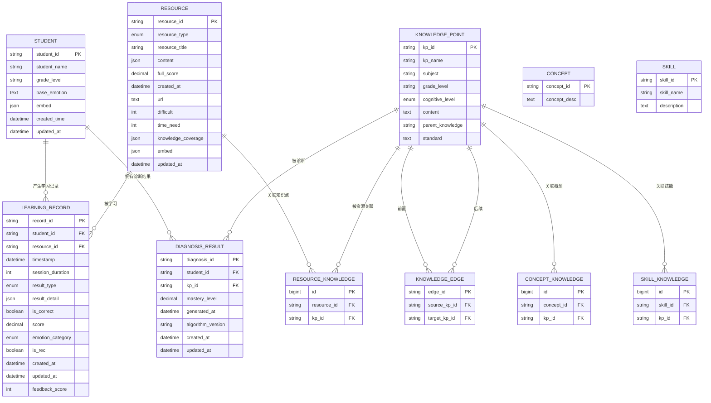

## 数据库设计方案

### 1. 学生表 (students) （共有） 

| 字段名       | 类型         | 约束                        | 说明               |
| ------------ | ------------ | --------------------------- | ------------------ |
| student_id   | VARCHAR(64)  | PK                          | 学生唯一标识       |
| student_name | VARCHAR(128) | NOT NULL                    | 学生姓名           |
| grade_level  | VARCHAR(32)  |                             | 年级/学段          |
| base_emotion | TEXT         |                             | 长期稳定的情感标签 |
| embed        | JSON         |                             | 学习者表征         |
| created_time | DATETIME     | DEFAULT CURRENT_TIMESTAMP   | 创建时间           |
| updated_at   | DATETIME     | ON UPDATE CURRENT_TIMESTAMP | 更新时间           |

---

### 2. 资源表 (resources)（共有） 

| 字段名         | 类型          | 约束                        | 说明                                         |
| -------------- | ------------- | --------------------------- | -------------------------------------------- |
| resource_id    | VARCHAR(64)   | PK                          | 资源唯一标识                                 |
| resource_type  | ENUM          | NOT NULL                    | QUESTION/MATERIAL/VIDEO/DOCUMENT/INTERACTIVE |
| resource_title | VARCHAR(256)  | NOT NULL                    | 资源标题                                     |
| content        | JSON          |                             | 资源内容（题目/材料详情）                    |
| full_score     | DECIMAL(10,2) |                             | 满分分值（题目适用）                         |
| created_at     | DATETIME      | DEFAULT CURRENT_TIMESTAMP   | 创建时间                                     |
| url            | TEXT          |                             | 资源访问地址                                 |
| difficult      | INT           |                             | 难度等级∈[1,3]，1=低，2=中，3=难             |
| time_need      | INT           |                             | 预计所需时长（秒）                           |
| embed          | JSON          |                             | 资源表征                                     |
| updated_at     | DATETIME      | ON UPDATE CURRENT_TIMESTAMP | 更新时间                                     |

---

### 3. 学生-资源关系表 (student_resource)（共有） 

| 字段名           | 类型          | 约束                        | 说明                                   |
| ---------------- | ------------- | --------------------------- | -------------------------------------- |
| record_id        | VARCHAR(64)   | PK                          | 记录唯一标识                           |
| student_id       | VARCHAR(64)   | FK                          | 学生ID                                 |
| resource_id      | VARCHAR(64)   | FK                          | 资源ID                                 |
| timestamp        | DATETIME      | NOT NULL                    | 学习时间戳                             |
| session_duration | INT           |                             | 学习时长（秒）                         |
| result_type      | ENUM          | NOT NULL                    | ANSWER/VIEW/INTERACTION                |
| result_detail    | JSON          |                             | 结果详情（答题/观看结果）              |
| is_correct       | BOOLEAN       |                             | 是否正确（答题适用）                   |
| score            | DECIMAL(10,2) |                             | 得分                                   |
| emotion_category | ENUM          |                             | 情感分类标签：困惑/沮丧/兴奋/焦虑      |
| is_rec           | BOOLEAN       | DEFAULT FALSE               | 是否源自推荐系统                       |
| created_at       | DATETIME      | DEFAULT CURRENT_TIMESTAMP   | 记录创建时间                           |
| updated_at       | DATETIME      | ON UPDATE CURRENT_TIMESTAMP | 记录更新时间                           |
| feedback_score   | INT           |                             | 学习者对资源的满意程度，取值范围 [0,5] |

---

### 4. 知识点表 (knowledges)（共有） 

| 字段名           | 类型         | 约束     | 说明                            |
| ---------------- | ------------ | -------- | ------------------------------- |
| kp_id            | VARCHAR(64)  | PK       | 知识点唯一标识                  |
| kp_name          | VARCHAR(256) | NOT NULL | 知识点名称                      |
| subject          | VARCHAR(64)  | NOT NULL | 所属学科                        |
| grade_level      | VARCHAR(32)  |          | 适用学段/年级（如“小学五年级”） |
| cognitive_level  | ENUM         |          | 认知层次（布鲁姆分类）          |
| content          | TEXT         |          | 知识点详细内容描述              |
| parent_knowledge | VARCHAR(64)  | FK       | 父知识点ID                      |
| standard         | TEXT         |          | 课标要求标签：掌握/理解/了解    |

---

### 5. 概念表 (concepts)（4.1）

| 字段名       | 类型        | 约束     | 说明               |
| ------------ | ----------- | -------- | ------------------ |
| concept_id   | VARCHAR(64) | PK       | 概念唯一标识       |
| concept_desc | TEXT        | NOT NULL | 概念的自然语言描述 |

> 概念是对知识点的自然语言解释，一个知识点可关联多个概念，一个概念也可关联多个知识点。

---

### 6. 技能表 (skills)（4.1）

| 字段名      | 类型         | 约束     | 说明                               |
| ----------- | ------------ | -------- | ---------------------------------- |
| skill_id    | VARCHAR(64)  | PK       | 技能唯一标识                       |
| skill_name  | VARCHAR(256) | NOT NULL | 技能名称                           |
| description | TEXT         |          | 技能详细描述（如“解一元二次方程”） |

> 技能指可训练、可测量的能力，与知识点存在多对多关系。

---

### 7. 资源-知识点关系表 (resource_knowledge)（共有）

| 字段名      | 类型        | 约束               | 说明     |
| ----------- | ----------- | ------------------ | -------- |
| id          | BIGINT      | PK, AUTO_INCREMENT | 自增ID   |
| resource_id | VARCHAR(64) | FK, NOT NULL       | 资源ID   |
| kp_id       | VARCHAR(64) | FK, NOT NULL       | 知识点ID |

---

### 8. 知识点-知识点关系表 (knowledge_knowledge)（共有）

| 字段名       | 类型        | 约束         | 说明         |
| ------------ | ----------- | ------------ | ------------ |
| edge_id      | VARCHAR(64) | PK           | 关系唯一标识 |
| source_kp_id | VARCHAR(64) | FK, NOT NULL | 前置知识点   |
| target_kp_id | VARCHAR(64) | FK, NOT NULL | 后续知识点   |

---

### 9. 概念-知识点关系表 (concept_knowledge)（4.1）

| 字段名     | 类型        | 约束               | 说明     |
| ---------- | ----------- | ------------------ | -------- |
| id         | BIGINT      | PK, AUTO_INCREMENT | 自增ID   |
| concept_id | VARCHAR(64) | FK, NOT NULL       | 概念ID   |
| kp_id      | VARCHAR(64) | FK, NOT NULL       | 知识点ID |

---

### 10. 技能-知识点关系表 (skill_knowledge)（4.1）

| 字段名   | 类型        | 约束               | 说明     |
| -------- | ----------- | ------------------ | -------- |
| id       | BIGINT      | PK, AUTO_INCREMENT | 自增ID   |
| skill_id | VARCHAR(64) | FK, NOT NULL       | 技能ID   |
| kp_id    | VARCHAR(64) | FK, NOT NULL       | 知识点ID |

---

### 11. 学生-知识点关系表 (student_knowledge)（共有） 

| 字段名            | 类型         | 约束                        | 说明                         |
| ----------------- | ------------ | --------------------------- | ---------------------------- |
| diagnosis_id      | VARCHAR(64)  | PK                          | 诊断报告唯一标识             |
| student_id        | VARCHAR(64)  | FK, NOT NULL                | 学生ID                       |
| kp_id             | VARCHAR(64)  | FK, NOT NULL                | 知识点ID                     |
| mastery_level     | DECIMAL(5,4) | NOT NULL                    | 掌握程度，取值范围 [0.0,1.0] |
| generated_at      | DATETIME     | NOT NULL                    | 诊断结论生成时间             |
| algorithm_version | VARCHAR(32)  |                             | 诊断算法版本号               |
| created_at        | DATETIME     | DEFAULT CURRENT_TIMESTAMP   | 记录创建时间                 |
| updated_at        | DATETIME     | ON UPDATE CURRENT_TIMESTAMP | 记录更新时间                 |

---

### 12. 学习者-学习者关系表 (`learner_learner_relations`)（4.2）

该表表示已有学伴关系，也是图模型的 learner-learner 边来源。学伴推荐默认过滤当前用户已有的关系，不会因展示推荐结果自动写入该表。

| 字段名 | 类型 | 约束 | 说明 |
|---|---|---|---|
| `id` | VARCHAR(36) | PK | 关系记录主键 |
| `learner_a_id`、`learner_b_id` | VARCHAR(36) | FK, NOT NULL | 两位学习者的 `users.id` |
| `grade_diff`、`behavior_sim`、`path_sim`、`knowledge_sim`、`emotion_sim`、`embed_sim` | FLOAT | 可空 | 可选的业务统计字段，不是在线图排序的直接输入 |
| `interactions_count` | INT | 可空 | 历史协作次数 |
| `score`、`feedback_score` | FLOAT | 可空 | 业务匹配分与反馈 |
| `is_rec` | BOOLEAN | 可空 | 是否来自推荐流程的业务标记 |
| `created_at`、`updated_at` | DATETIME | NOT NULL | 关系创建与更新时间；`created_at` 用于学伴任务时间切分 |

---

### 13. 资源推荐记录表 (`resource_recommendations`)（4.2）

| 字段名 | 类型 | 约束 | 说明 |
|---|---|---|---|
| `id` | VARCHAR(36) | PK | 推荐记录主键 |
| `session_id` | VARCHAR(36) | FK, 可空 | 所属会话 |
| `learner_id` | VARCHAR(36) | FK, NOT NULL | 请求推荐的学习者 |
| `candidates` | JSON | 可空 | SQL 或全集候选及其来源 |
| `rec_num` | INT | 可空 | 最终返回数量 |
| `labels` | JSON | 可空 | planning、reflection、trace、执行上下文和历史 |
| `kg_version`、`model_version` | VARCHAR | 可空 | 知识图谱与模型版本标记 |
| `rec_resources` | JSON | 可空 | 最终资源对象列表 |
| `rec_ranks` | JSON | 可空 | `rank`、`resource_id`、`graph_score` 或相似度锚点信息 |
| `feedback_score` | FLOAT | 可空 | 用户反馈评分 |
| `created_at` | DATETIME | NOT NULL | 推荐产生时间 |

---

### 14. 学伴推荐记录表 (`buddy_recommendations`)（4.2）

| 字段名 | 类型 | 约束 | 说明 |
|---|---|---|---|
| `id` | VARCHAR(36) | PK | 推荐记录主键 |
| `session_id` | VARCHAR(36) | FK, 可空 | 所属会话 |
| `learner_id` | VARCHAR(36) | FK, NOT NULL | 请求学伴推荐的学习者 |
| `candidates` | JSON | 可空 | SQL 或活跃用户全集候选 |
| `rec_num` | INT | 可空 | 最终返回数量 |
| `train_labels` | JSON | 可空 | planning、reflection、trace、执行上下文和历史 |
| `kg_version`、`model_version` | VARCHAR | 可空 | 知识图谱与模型版本标记 |
| `rec_strategy` | VARCHAR(64) | 可空 | 本轮召回策略说明 |
| `rec_partners` | JSON | 可空 | 最终学伴对象列表 |
| `rec_ranks` | JSON | 可空 | `rank`、`learner_id`、`graph_score`、`similarity_score` 与展示分数 |
| `rec_feedback` | FLOAT | 可空 | 用户反馈评分 |
| `created_at` | DATETIME | NOT NULL | 推荐产生时间 |

---

### 15. 图节点 Embedding 缓存表 (`graph_node_embeddings`)

该表持久化冻结文本 Embedding，避免每次服务启动重新编码。它不是模型 checkpoint，也不参与在线训练。

| 字段名 | 类型 | 约束 | 说明 |
|---|---|---|---|
| `id` | VARCHAR(36) | PK | 缓存记录主键 |
| `entity_type`、`entity_id` | VARCHAR | NOT NULL | `learner`、`resource`、`knowledge_point` 及其数据库 ID |
| `embedding_model_id` | VARCHAR(255) | NOT NULL | 文本模型名称或本地目录标识 |
| `text_template_version` | VARCHAR(64) | NOT NULL | 节点文本模板版本 |
| `text_hash` | VARCHAR(64) | NOT NULL | 用于识别源文本是否变化 |
| `embedding_dim` | INT | NOT NULL | 向量维度 |
| `embedding_vector` | JSON | NOT NULL | 浮点向量 |
| `created_at`、`updated_at` | DATETIME | NOT NULL | 缓存创建与更新时间 |

唯一键为 `(entity_type, entity_id, embedding_model_id, text_template_version)`。

---

## 完整ER图

---

## 关系说明表

| 关系                                         | 类型    | 说明                                              |
| -------------------------------------------- | ------- | ------------------------------------------------- |
| Student → Learning_Record                    | 1:N     | 一个学生有多条学习记录                            |
| Resource → Learning_Record                   | 1:N     | 一个资源可被多次学习                              |
| Resource ↔ Knowledge_Point                   | N:M     | 通过 `resource_knowledge` 关联                    |
| Knowledge_Point → Knowledge_Edge             | 1:N     | 知识点的前置/后续关系（自关联）                   |
| Student + Knowledge_Point → Diagnosis_Result | 联合1:N | 学生对各知识点的掌握程度                          |
| Concept ↔ Knowledge_Point                    | N:M     | 通过 `concept_knowledge` 关联，概念可描述知识点   |
| Skill ↔ Knowledge_Point                      | N:M     | 通过 `skill_knowledge` 关联，技能可关联多个知识点 |

---
