# SmartTutor 系统架构总结(用于生成架构图)

> 多智能体自适应教育系统。后端 FastAPI + LangGraph,前端 React + TypeScript,集成真实 KT(REKT)与 CTR 排序两个 ML 模型。本文档面向 AI 消费,目标是生成准确的系统架构图。

---

## 1. 一句话定位

**学生发一条消息 → 后端依次跑「安全管线 → 情感分析 → 决策路由 → Stage 串行调度多个 Agent → 组装回复」,全程 SSE 流式推送 thinking 事件到前端右侧智能体面板;中间可调用真实 REKT 知识追踪模型与 CTR 资源排序模型。**

---

## 2. 技术栈

| 层级 | 技术选型 |
|------|----------|
| 前端框架 | React 18 + TypeScript + Vite 6 |
| 前端状态 | Zustand(authStore 持久化、chatStore 内存、uiStore 仅持久化 theme) |
| 前端样式 | TailwindCSS |
| 后端框架 | FastAPI + Uvicorn(async) |
| 编排引擎 | LangGraph + LangChain |
| ORM | SQLAlchemy 2.0 (async) + Alembic 迁移 |
| 数据库 | SQLite(aiosqlite,开发默认) / MySQL(aiomysql,生产) |
| 配置 | pydantic-settings(环境变量前缀 `SMART_TUTOR_`) |
| 认证 | JWT(PyJWT)+ bcrypt;access/refresh 双 token |
| 流式协议 | SSE(Server-Sent Events,`text/event-stream`)+ 可选 WebSocket |
| ML 推理 | PyTorch 2.12(REKT 知识追踪、CTR ranking) |

---

## 3. 顶层分层架构

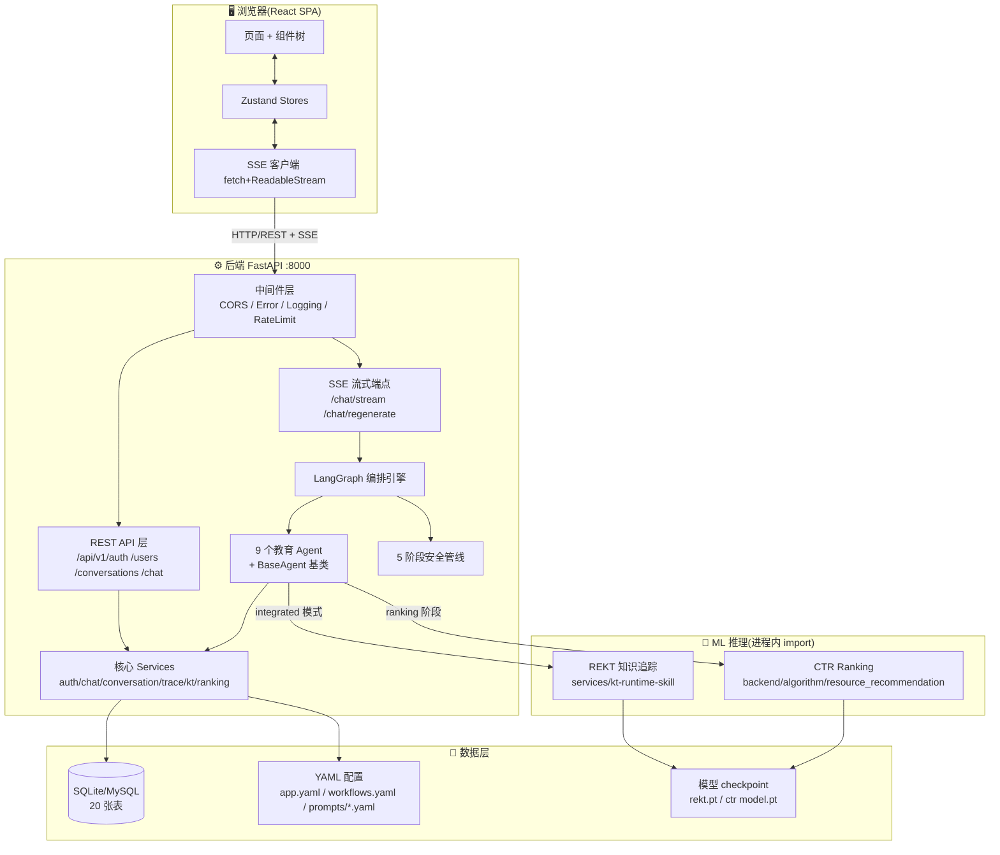

---

## 4. 后端架构详解

### 4.1 API 层(全局前缀 `/api/v1`)

| Router | 端点 | 说明 |
|--------|------|------|
| `/auth` | `POST register / login / refresh / logout`、`GET me` | JWT 认证 |
| `/users` | `GET/PUT profile`、`GET stats`、`GET knowledge-graph` | 用户画像与知识图谱 |
| `/conversations` | `GET list`、`POST create`、`GET/DELETE {id}`、`PUT {id}/title` | 会话 CRUD |
| `/chat` | `POST send`(同步)、`POST stream`(**SSE**)、`POST regenerate`(SSE)、`WS ws/{id}`、`POST feedback`、`GET history`、`GET turns/{id}/agents` | 核心对话 |

### 4.2 中间件(注册顺序)

```
CORSMiddleware → ErrorHandlerMiddleware → LoggingMiddleware → RateLimiterMiddleware
```

### 4.3 LangGraph 图拓扑

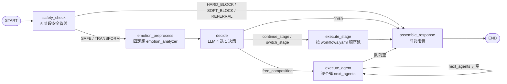

**节点清单**

| 节点 | 函数 | 职责 |
|------|------|------|
| `safety_check` | `safety_gate.safety_gate` | 5 阶段安全管线(风险感知 → 意图识别 → 价值评估 → 教育引导 → 问题转化) |
| `emotion_preprocess` | `emotion_preprocess.emotion_preprocess` | 每轮强制跑 emotion_analyzer,写入 `ctx["emotion_analyzer"]` |
| `decide` | `decision_node.decision_node` | LLM 决策路由,4 选 1 |
| `execute_stage` | `stage_executor.stage_executor` | 按 workflow 当前 stage 的 agent 序列顺序执行 |
| `execute_agent` | `agent_node.agent_node` | 自由组合模式,逐个 pop `next_agents` |
| `assemble_response` | `response_assembler.response_assembler` | 最终回复拼装,兜底回退到 empathy_generator |

### 4.4 5 阶段安全管线

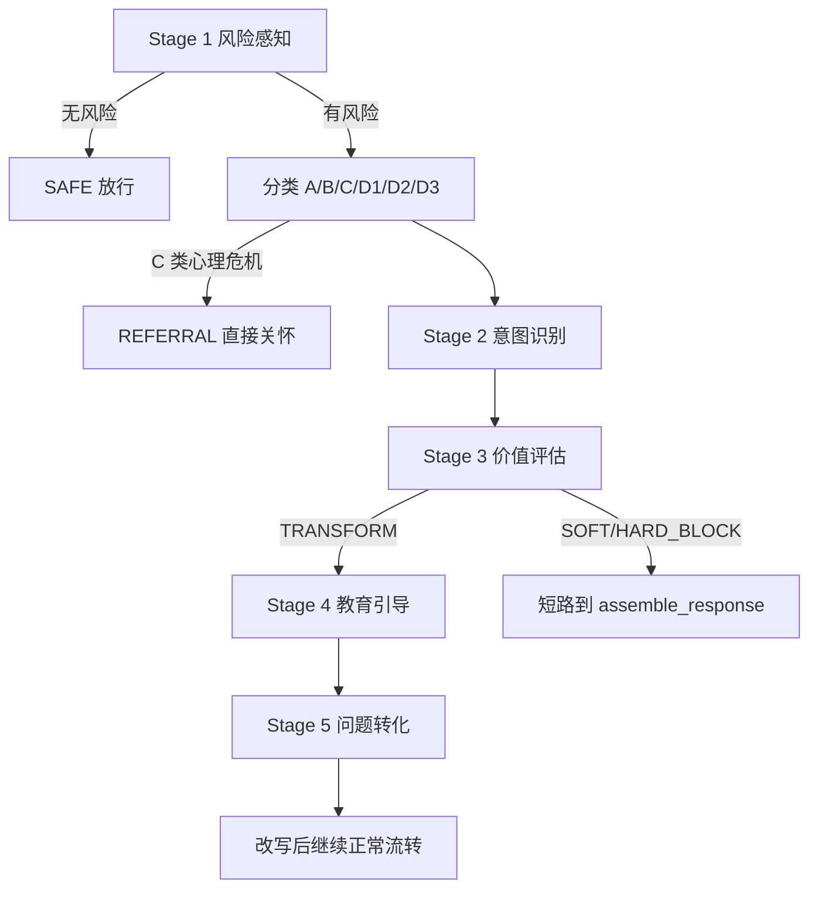

| 类别 | 说明 | 默认处置 |
|------|------|----------|
| A | 危险操作 | TRANSFORM |
| B | 学段不当 | TRANSFORM |
| C | 心理危机 | REFERRAL |
| D1/D2/D3 | 伦理敏感 | TRANSFORM |

---

## 5. Agent 架构详解

### 5.1 BaseAgent 统一管线

所有 9 个 Agent 继承 `BaseAgent`,走同一条处理链:

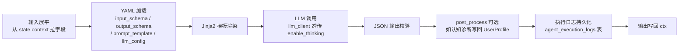

### 5.2 9 个 Agent 清单

| Agent | 职责 | 输入(ctx 展平) | 输出(ctx 字段) | temp |
|-------|------|--------|--------|------|
| `safety_monitor` | 安全分类(管线内部用) | 输入文本 | 安全标签 | - |
| `emotion_analyzer` | 情绪识别(每轮固定跑) | current_message / recent_messages / user_profile | emotion_state | 0.4 |
| `cognitive_diagnosis` | 知识掌握度评估(可接 KT) | student_id / targets / current_message / history_context / user_profile | knowledge_states / mastery_rates / weak_points / diagnosis_source | 0.3 |
| `learning_path` | 学习路径规划 | cognitive_diagnosis / user_profile | learning_plan | 0.3 |
| `resource_recommender` | 资源推荐(可接 CTR) | user_id / target_knowledge / user_profile / stage | resource_list + plan/reflection/summary 三阶段 | 0.4 |
| `study_buddy` | 学伴匹配 | user_profile / cognitive_diagnosis | buddy_info | 0.5 |
| `knowledge_responder` | 核心讲解生成(主回复) | current_message / emotion_state / cognitive_diagnosis / safety_context | response_text | 0.7 |
| `content_polisher` | 教学内容润色 | 上一 agent 的 _last_output | polished_content | 0.4 |
| `empathy_generator` | 共情回复(通常压轴) | emotion_state / _last_output / safety_context | empathetic_response | 0.6 |

### 5.3 Agent 数据流

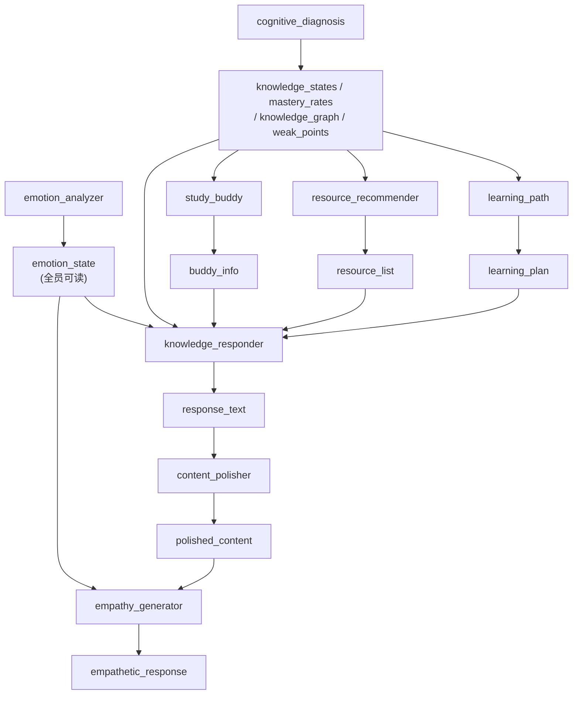

### 5.4 Workflow × Stage 编排

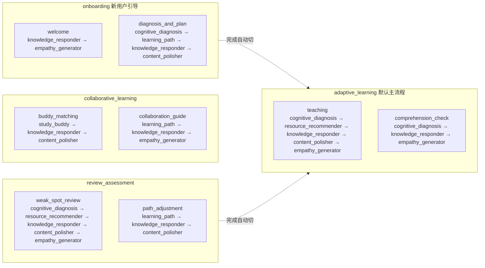

---

## 6. 外部 ML 模型集成

### 6.1 KT 知识追踪(REKT)— 三种模式

环境变量 `SMART_TUTOR_KT__MODE` 控制:

| 模式 | 行为 |
|------|------|
| `off`(默认) | cognitive_diagnosis 走纯 LLM 模拟,数值可能幻觉 |
| `integrated` ⭐ | **进程内 import** `services/kt-runtime-skill/scripts/kt_runtime/api.py`,调用 `predict_from_student_id`,REKT 输出作为 ground truth 强制覆盖 LLM 数值字段,LLM 仅做认知归因 |
| `standalone` | KT 走独立 ChatAgent 服务(前端 iframe),cognitive_diagnosis 同 `off` |

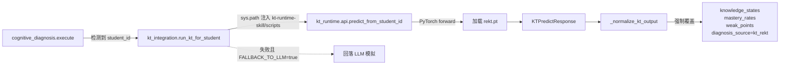

### 6.2 CTR 资源排序

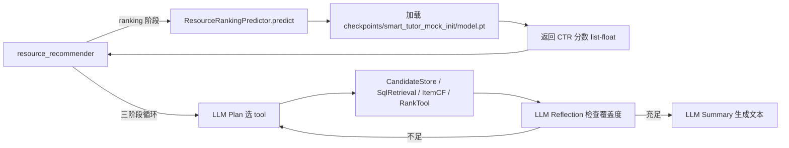

**SQL 检索工具三层安全**:语法校验 → 表名白名单+关键字黑名单 → Session 级只读(`PRAGMA query_only` / `SET TRANSACTION READ ONLY`)。

---

## 7. 前端架构详解

### 7.1 路由清单

| 路径 | 组件 | 访问控制 |
|------|------|----------|
| `/login` | LoginPage | public(已登录跳 `/dashboard/chat`) |
| `/register` | RegisterPage | public |
| `/dashboard` | MainLayout(Outlet) | protected |
| `/dashboard/chat` | DashboardPage | protected |
| `/dashboard/chat/:conversationId` | DashboardPage | protected |
| `/dashboard/kt-diagnosis` | KtDiagnosisPage | protected(仅 `VITE_KT_STANDALONE==='true'` 时挂载) |

### 7.2 Store 结构

| Store | 持久化 | 关键 state |
|-------|--------|-----------|
| `authStore` | localStorage(`smart-tutor-auth`) | user / accessToken / refreshToken / isAuthenticated |
| `chatStore` | 无 | conversations / messages / streamingContent / thinkingSteps / agentTrace / currentTurn / turnHistory / currentFocusAgents / currentTouchedNodes / activeNodeId / selectedDetailAgent |
| `uiStore` | 部分(仅 theme) | sidebarOpen / theme / rightPanelOpen / selectedAgent |

### 7.3 组件树

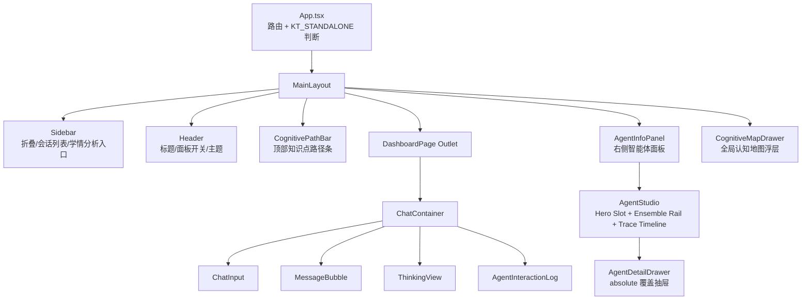

### 7.4 SSE 事件协议与 store 映射

通过原生 `fetch + ReadableStream.getReader()` 连接 `POST /api/v1/chat/stream`,带 `Authorization: Bearer`,手动解析 `data: ` 前缀的 JSON。

| event type | 关键字段 | chatStore action | UI 反应 |
|------------|---------|------------------|---------|
| `content` | content | `updateStreamingContent` | 气泡内文字累加 |
| `step` | step / label | `setCurrentStep` + `addThinkingStep(running)` | "正在运行认知诊断..."标签 |
| `thinking` | content / step / label | `completeRunningStep` → 写入 `agentTrace[step]` + 更新 timeline | 右栏 Agent 卡片显示输出 |
| `done` | focusAgents / touchedNodes / trajectory / ktSummary | `finalizeTurn` + `finishStreaming` | 流式落为 assistant message,push turnHistory |
| `error` | detail | `toast.error` + `finishStreaming` | 错误提示 |

### 7.5 Vite 配置

- dev 端口:3000
- proxy:`/api → http://localhost:8000`(changeOrigin)
- alias:`@ → ./src`
- 环境变量:`VITE_KT_STANDALONE`(控制 kt-diagnosis 路由)、`VITE_API_URL`(留空走 proxy)、`VITE_KT_CHATAGENT_URL`

---

## 8. 数据层(20 张表)

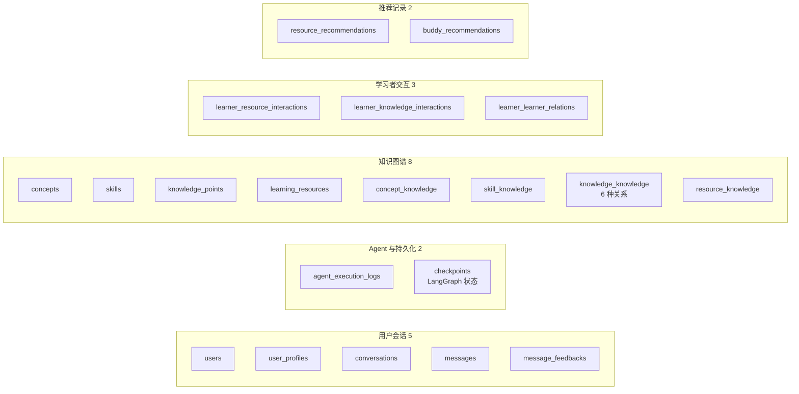

关系类型(在 `knowledge_knowledge`):`prerequisite / related / contains / applies_to / extends_to / constrained_by`。

---

## 9. 端到端数据流(发一条消息的全过程)

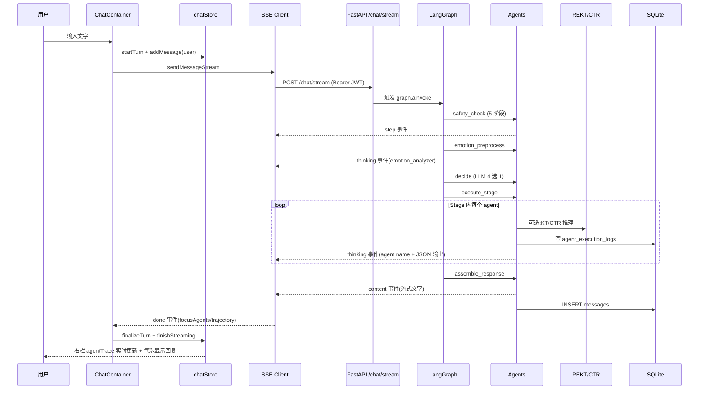

---

## 10. 部署与端口

| 服务 | 端口 | 启动 |
|------|------|------|
| 前端 dev | 3000 | `cd frontend && npm run dev` |
| 后端 API | 8000 | `cd backend && uvicorn app.main:app --reload` |
| ChatAgent(standalone 模式) | 8910 | `cd services/chat-agent && python -m chat_agent.server` |
| MySQL(生产) | 3306 | docker-compose |

**KT 模式**:由 `SMART_TUTOR_KT__MODE` 控制(off / integrated / standalone),integrated 模式不需要 ChatAgent 服务。

---

## 11. 给画图 AI 的关键提示

生成架构图时请注意以下要点:

1. **必须体现的横向流**:用户 → 前端 SPA → SSE → LangGraph → Agents → ML 模型 → DB
2. **必须体现的纵向分层**:展示层 / API 层 / 编排层 / Agent 层 / Service 层 / 模型层 / 数据层
3. **Agent 不是并列的**:emotion_analyzer 在 stage 外固定执行;safety_monitor 在安全管线内部;其他 7 个按 stage 编排
4. **两个 ML 模型是进程内 import,不是微服务**(integrated 模式),不要画成独立 service
5. **SSE 是主流通道**,WebSocket 是可选备选
6. **BaseAgent 是统一基类**,9 个 agent 共享「YAML → Jinja2 → LLM → JSON 校验 → 日志」管线
7. **前端右侧面板是本次重点**,要体现 SSE thinking 事件 → agentTrace → AgentStudio 三段式的数据路径
8. **Workflow 有 4 种**,default 是 adaptive_learning;workflow 之间有自动切换关系
9. **数据库 20 张表**,按 5 个域分组(用户会话 / Agent 持久化 / 知识图谱 / 学习者交互 / 推荐记录)
10. **5 阶段安全管线**是独立子流程,在 graph 入口强制执行
